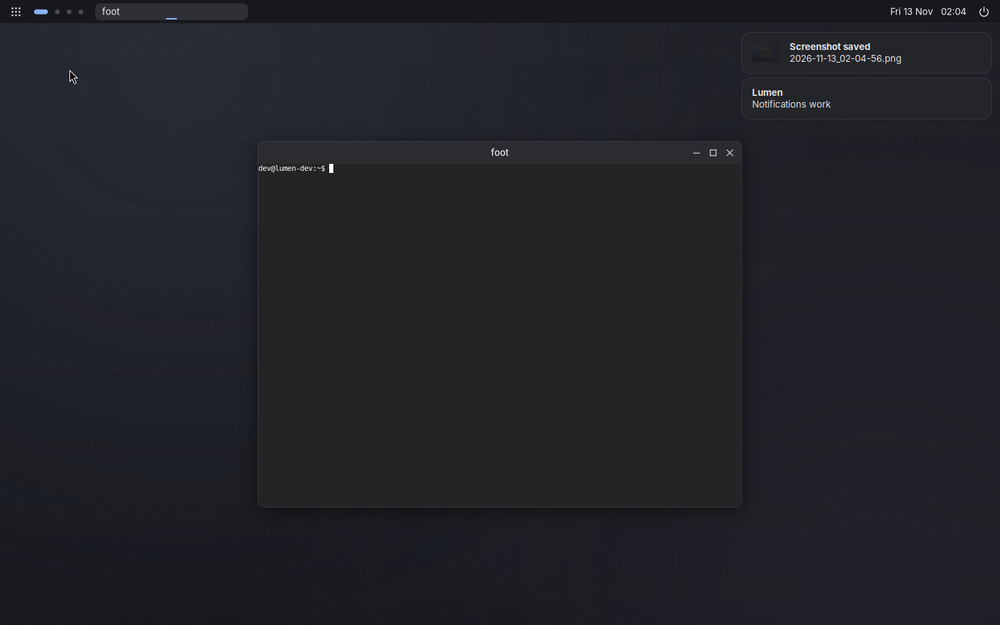
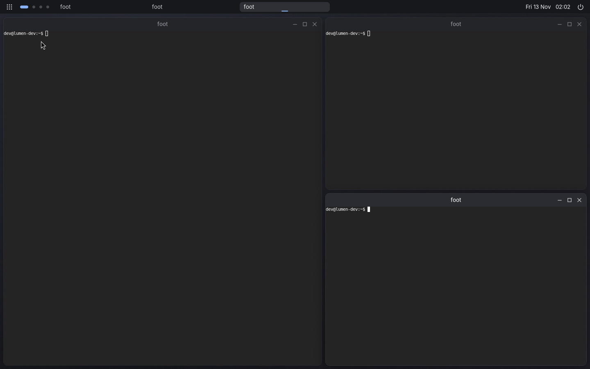
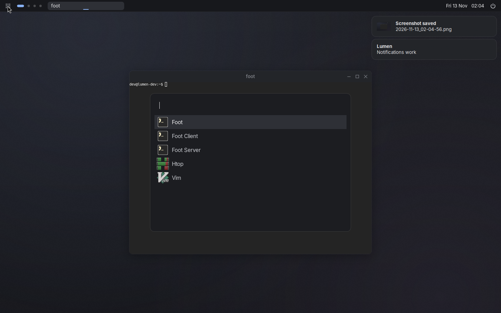
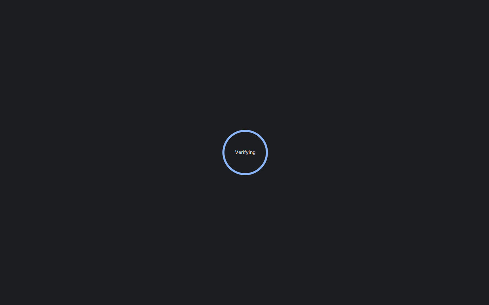

# Lumen

A light, good-looking Wayland desktop for Debian 13 (trixie).

Lumen is a small compositor built on [wlroots 0.18](https://gitlab.freedesktop.org/wlroots/wlroots) +
[SceneFX](https://github.com/wlrfx/scenefx) (rounded corners, soft shadows, blur), a tiny native panel,
and a handful of proven Wayland tools glued into one coherent session. It does floating **and**
tiling, and installs as a separate login session — your existing desktop (e.g. XFCE) stays untouched
and remains the default.



| Tiling (master/stack) | Launcher | Lock screen |
|---|---|---|
|  |  |  |

## What's in the box

| Piece | What it is |
|---|---|
| `lumen` | The compositor: floating + per-workspace master/stack tiling, server-side decorations with min/max/close, rounded corners, shadows, 9 workspaces, layer-shell, session lock, idle notify/inhibit, foreign-toplevel, cursor-shape, IPC socket |
| `lumen-panel` | Top bar (cairo/pango, ~12 MB RSS): launcher button, workspace pills, taskbar, battery, clock, power menu |
| `lumen-session` | Session entry point; sets env vars and seeds default configs on first login |
| `lumen-lock` | Themed `swaylock` |
| `lumen-power` | Lock / Log out / Suspend / Restart / Shut down menu (fuzzel) |
| `lumen-screenshot` | Full-screen or region (`slurp`) screenshot → `~/Pictures/Screenshots` + clipboard + notification |
| Configs | Dark themes for fuzzel (launcher) and mako (notifications); `swayidle` locks after 5 min, screen off after 10 |

## Install (Debian 13 trixie, amd64)

Grab `lumen_<version>_amd64.deb` from the Releases page (or build it, below), then:

```sh
sudo apt install ./lumen_0.1.0_amd64.deb
```

Log out, pick **Lumen** in the session menu on the LightDM login screen, and log in.
To go back, just pick your old session (Xfce) again. Remove with `sudo apt remove lumen`.

Your config lives in `~/.config/lumen/lumen.conf` (created on first login, fully commented).
Reload with **Super+Shift+R**.

## Keys

| Keys | Action |
|---|---|
| Super+Return | Terminal (foot) |
| Super+D / Super+Space | App launcher |
| Super+Q | Close window |
| Super+F / Super+M / Super+N | Fullscreen / maximise / minimise |
| Super+T | Toggle tiling for this workspace |
| Super+V | Float/unfloat window |
| Super+J / Super+K, Alt+Tab | Focus next / previous |
| Super+[ / Super+] | Shrink / grow master area |
| Super+Shift+Return | Swap with master |
| Super+1…9 / Super+Shift+1…9 | Go to workspace / move window there |
| Super+L | Lock |
| Super+Escape | Session menu |
| Print / Shift+Print | Screenshot / region screenshot |
| Volume & brightness keys | `pactl` / `brightnessctl` |
| Super+Shift+R / Super+Shift+E | Reload config / log out |
| Super+drag, Super+right-drag | Move / resize |

Panel: click a workspace dot to switch (or scroll over them); click a task to focus/minimise,
middle-click to close.

## Scripting

```sh
lumen --msg "workspace 3"      # any bind action works: exec, close, toggle-tiling, dpms off, …
```

The socket (`$LUMEN_SOCK`) also accepts `state` and `subscribe` (pushes `ws <active> <occupied-mask> <tiling>`).

## Build

### A .deb from any machine with Docker (e.g. a Mac)

```sh
packaging/docker-build.sh          # -> dist/lumen_0.1.0_amd64.deb
packaging/docker-build.sh arm64    # -> dist/lumen_0.1.0_arm64.deb
```

The script builds SceneFX 0.2.1 (with `patches/`) as a static library and links it into `lumen`,
so the package only depends on stock Debian packages.

### Directly on Debian 13

```sh
packaging/build-deb.sh             # installs build deps with sudo, writes dist/*.deb
```

or for development (needs SceneFX 0.2 installed system-wide):

```sh
meson setup build --prefix=/usr && ninja -C build && sudo ninja -C build install
```

## Development VM (macOS / Apple Silicon)

`vm/` holds the scripts used to develop Lumen against a Debian 13 arm64 cloud image under QEMU
(HVF acceleration, virtio-gpu, so rendering goes through Mesa llvmpipe):

- `vm/start.sh` — boot headless; VNC on `127.0.0.1:5905`, SSH on port 2222, QMP on `vm/qmp.sock`
- `vm/ssh.sh` — SSH in; `vm/vmctl.py` — inject keys/clicks/text via QMP; `vm/grab.sh` — screenshot via grim

The disk images, SSH keys and cloud-init seed are not in the repo. To recreate: download
`debian-13-generic-arm64.qcow2`, make `disk.qcow2` as an overlay of it, generate `vm/id_vm`, and
build `seed.iso` from a cloud-init `user-data` that creates a user with that key.

## Resource use

Measured in the VM (1440×900, one terminal open):

| Process | RSS |
|---|---|
| lumen-panel | ~12 MB |
| mako | ~20 MB |
| swayidle | ~3 MB |
| lumen | ~180 MB in the VM — ~65 MB of that is LLVM/llvmpipe code and most of the rest is software-rendered blur/shadow buffers; on a real GPU (Intel iris) these live in GPU memory and the compositor is far smaller |

Whole system idle: ~360 MB used.

## Known gaps

- No XWayland yet (X11-only apps won't open)
- No system tray / network / volume applets in the panel (use `nmtui`, `pactl`, or add your own)
- Panel shows on one output only; multi-monitor is basic
- No output-management protocol (no `wlr-randr`/kanshi); screen-off is via `lumen --msg "dpms off"`

## License

MIT
